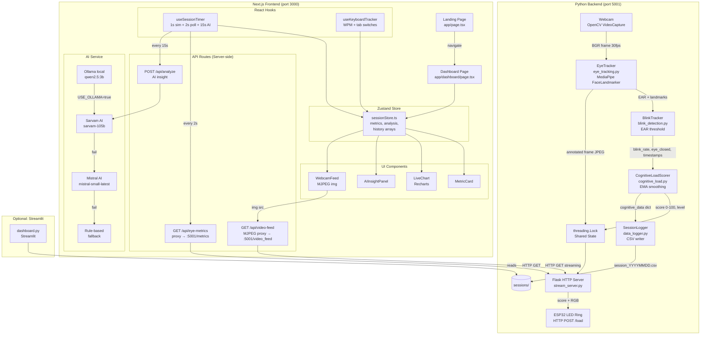

# NeuroSync — Technical Documentation

**AI-Powered Real-Time Cognitive Load Monitor for Developers**
*Version 1.0 | August 2026 | Major Project Phase II*

---

## Table of Contents

1. [Project Overview and Purpose](#1-project-overview-and-purpose)
2. [Key Features](#2-key-features)
3. [Technology Stack](#3-technology-stack)
4. [Project and Folder Structure](#4-project-and-folder-structure)
5. [System Architecture](#5-system-architecture)
6. [Architecture Diagram](#6-architecture-diagram)
7. [Detailed Data Flow](#7-detailed-data-flow)
8. [Backend Architecture](#8-backend-architecture)
9. [AI / LLM Architecture and Workflow](#9-ai--llm-architecture-and-workflow)
10. [All Modules, Classes, and Their Responsibilities](#10-all-modules-classes-and-their-responsibilities)
11. [Database Architecture, Schema, and Interaction](#11-database-architecture-schema-and-interaction)
12. [API Endpoints](#12-api-endpoints)
13. [Configuration and Environment Variables](#13-configuration-and-environment-variables)
14. [Dependency Information](#14-dependency-information)
15. [Error Handling and Validation](#15-error-handling-and-validation)
16. [Important Design Decisions](#16-important-design-decisions)
17. [External Services and APIs Used](#17-external-services-and-apis-used)
18. [Installation and Running the Project](#18-installation-and-running-the-project)
19. [Example End-to-End Execution Flow](#19-example-end-to-end-execution-flow)
20. [Known Limitations and Potential Improvements](#20-known-limitations-and-potential-improvements)

---

## 1. Project Overview and Purpose

NeuroSync is a real-time cognitive load monitoring system for software developers. It uses a standard webcam — no wearable hardware — to continuously measure how mentally taxed a developer is during an active work session. The system produces a 0–100 cognitive load score every frame, maps it to a LOW / MEDIUM / HIGH level, and surfaces AI-generated insights and recommendations every 15 seconds.

**The core thesis** is that blink rate (blinking frequency measured over a rolling 60-second window) is a scientifically validated proxy for cognitive load. Heavily suppressed blinking indicates deep, high-load focus; bursts of rapid blinking signal stress. The system exploits both signals simultaneously.

**What it is not**: it is not a drowsiness monitor (though a secondary drowsiness flag is produced), not a gaze tracker, and not a productivity rating system. The cognitive score reflects mental effort, not work quality.

**Project context**: Developed as a Major Project Phase II in the 2026–2027 academic year, currently at Technology Readiness Level 5 (validated in a relevant environment with real users).

---

## 2. Key Features

- **Real-time eye tracking** using MediaPipe FaceLandmarker (478 facial landmarks at ~30 fps) via a standard webcam.
- **Eye Aspect Ratio (EAR) calculation** from 6 landmark points per eye to detect blinks and eye closures.
- **Blink suppression detection** — the primary cognitive load signal. Below-normal blink rates (< 12/min) indicate elevated mental workload.
- **Blink burst detection** — detects rapid clusters of blinks within a 10-second window as a secondary stress signal.
- **EMA-smoothed cognitive load scoring** — score drifts rather than spikes, filtering noise while remaining responsive.
- **Eye-closure gating** — the score is frozen while eyes are closed so intentional blinking or rest cannot artificially spike the load reading.
- **Drowsiness warning** — triggered when eyes remain continuously closed for ≥ 2 seconds.
- **MJPEG live video stream** with annotated face mesh and HUD overlay, served via Flask on port 5001.
- **Next.js dashboard (NeuroSync)** displaying live metrics, three line charts (focus, cognitive load, EAR history), a webcam feed, and AI insights.
- **Browser-level behavioral signals** — keystroke-based WPM (10-second rolling window) and tab-switch counting via `visibilitychange` + `blur` events.
- **Multi-tier AI insights** — Sarvam AI (primary) → Mistral AI (fallback) → local Ollama (override) → rule-based deterministic fallback.
- **CSV session logging** — one row per second written to `sessions/session_YYYYMMDD_HHMMSS.csv`.
- **Streamlit dashboard** — reads session CSVs and renders live-refreshing charts for post-session analysis.
- **ESP32 hardware integration** (optional) — pushes cognitive score and RGB LED color to a 12-LED ring over HTTP POST at 1-second intervals.

---

## 3. Technology Stack

### Python Backend

| Component | Library / Tool | Version | Purpose |
|---|---|---|---|
| Computer vision | OpenCV (`opencv-python`) | ≥ 4.9.0 | Webcam capture, frame processing, HUD rendering, JPEG encoding |
| Face landmark detection | MediaPipe (`mediapipe`) | ≥ 0.10.14 | FaceLandmarker Tasks API — 478-point landmark detection |
| On-device inference | TensorFlow Lite / XNNPACK | bundled with MediaPipe | Hardware-accelerated landmark inference |
| Numerical computation | NumPy | ≥ 1.26.0 | EAR distance calculations |
| HTTP server | Flask | 3.1.3 (used; **not listed in requirements.txt**) | MJPEG stream + JSON metrics + health endpoints |
| Data analysis dashboard | Streamlit | ≥ 1.35.0 | Session CSV visualization dashboard |
| Data manipulation | Pandas | ≥ 2.2.0 | Loading and aggregating session CSVs |
| Language | Python | 3.12 | Core language |

### Next.js Frontend (Focus-plus / NeuroSync)

| Component | Library | Version | Purpose |
|---|---|---|---|
| Framework | Next.js | 16.2.6 | Full-stack React framework, App Router, Server Components, API Routes |
| UI | React | 19.2.4 | Component model |
| Type safety | TypeScript | 5 | Static typing |
| State management | Zustand | 5.0.13 | Global session state store |
| Animation | Framer Motion | 12.38.0 | Metric card animations, progress bar transitions |
| Charts | Recharts | 3.8.1 | Live line charts for metric histories |
| Styling | Tailwind CSS | 4 | Utility-first styling |
| Utility | clsx, tailwind-merge | 2.x / 3.x | Conditional class name composition |
| Icons | lucide-react | 1.16.0 | Icon set |
| Class variance | class-variance-authority | 0.7.1 | Component variant management |

### AI / LLM Layer

| Provider | Model | Role |
|---|---|---|
| Sarvam AI | sarvam-105b | Primary cloud LLM for insight generation |
| Mistral AI | mistral-small-latest | Cloud fallback LLM |
| Ollama (local) | qwen2.5:3b | Local inference override (active in current `.env.local`) |
| Rule-based | — | Deterministic fallback requiring no network or model |

### Hardware (Optional)

| Component | Purpose |
|---|---|
| Standard webcam (720p+) | Eye tracking input |
| ESP32 microcontroller | Physical cognitive load feedback via 12-LED RGB ring |

---

## 4. Project and Folder Structure

```
developer_cognitiv_load/                 ← workspace root
│
├── webcam_test.py                        ← standalone CLI entry point (no server)
├── stream_server.py                      ← Flask HTTP server (MJPEG + JSON API)
├── eye_tracking.py                       ← MediaPipe FaceLandmarker wrapper
├── blink_detection.py                    ← EAR-based blink + closure tracker
├── cognitive_load.py                     ← Cognitive load scoring engine
├── data_logger.py                        ← CSV session logger
├── utils.py                              ← EAR formula, landmark indices, HUD draw helpers
├── dashboard.py                          ← Streamlit post-session analytics dashboard
│
├── face_landmarker.task                  ← MediaPipe FaceLandmarker model (auto-downloaded; .gitignored)
├── blaze_face_short_range.tflite         ← BlazeFace model (present but not directly used by current code)
├── requirements.txt                      ← Python dependencies (note: Flask is missing)
├── .gitignore
├── PROJECT_REPORT.md                     ← Academic project report
│
├── sessions/                             ← CSV session logs (gitignored)
│   └── session_YYYYMMDD_HHMMSS.csv
│
└── keyboard_implementation/
    └── Focus-plus/                       ← Next.js application (NeuroSync dashboard)
        │
        ├── app/                          ← Next.js App Router pages and API routes
        │   ├── layout.tsx                ← Root HTML layout, metadata, dark class
        │   ├── page.tsx                  ← Landing page (/)
        │   ├── globals.css               ← Tailwind import + global resets
        │   ├── dashboard/
        │   │   └── page.tsx              ← Main dashboard (/dashboard)
        │   └── api/
        │       ├── analyze/
        │       │   └── route.ts          ← POST /api/analyze — AI insight endpoint
        │       ├── eye-metrics/
        │       │   └── route.ts          ← GET /api/eye-metrics — proxy to Python :5001/metrics
        │       └── video-feed/
        │           └── route.ts          ← GET /api/video-feed — MJPEG proxy to Python :5001/video_feed
        │
        ├── components/
        │   └── ui/
        │       ├── MetricCard.tsx        ← Glassmorphism card with animated fill bar
        │       ├── LiveChart.tsx         ← Recharts line chart for metric history arrays
        │       ├── AIInsightPanel.tsx    ← AI insight display with provider badge + alert level
        │       └── WebcamFeed.tsx        ← MJPEG  with connection-state overlay
        │
        ├── hooks/
        │   ├── useSessionTimer.ts        ← 1s sim tick, 2s eye poll, 15s AI trigger
        │   └── useKeyboardTracker.ts     ← Browser keydown WPM + tab-switch counting
        │
        ├── services/
        │   └── ai.ts                     ← AI layer: Sarvam → Mistral → Ollama → rule-based
        │
        ├── store/
        │   └── sessionStore.ts           ← Zustand store: session state + metric history buffers
        │
        ├── package.json
        ├── next.config.ts
        ├── tsconfig.json
        ├── .env.example                  ← Environment variable template
        └── .env.local                    ← Active secrets (gitignored in Focus-plus/.gitignore)
```

### Important Files Explained

| File | What it does | Why it exists |
|---|---|---|
| `webcam_test.py` | Standalone CLI pipeline — captures webcam, runs full pipeline, displays OpenCV window | Usable without Flask or Next.js; self-contained for testing |
| `stream_server.py` | Flask server exposing MJPEG stream + JSON metrics to the Next.js frontend | Bridges the Python CV pipeline to the browser |
| `eye_tracking.py` | Wraps MediaPipe FaceLandmarker, auto-downloads model, draws face mesh, computes EAR | Isolates the CV model dependency; handles the MediaPipe 0.10+ Tasks API breaking changes |
| `blink_detection.py` | Stateful EAR threshold tracker producing blink counts, rate, closure duration, drowsy flag | Separates blink logic from scoring logic |
| `cognitive_load.py` | EMA-smoothed scoring algorithm using only blink rate and burst count | Isolated so the scoring algorithm can be tuned or replaced independently |
| `data_logger.py` | Rate-limited CSV writer (1 row/sec) with timestamped filename | Produces persistent longitudinal session data |
| `utils.py` | EAR formula, landmark index constants, HUD and load indicator drawing functions | Shared utilities usable by both `webcam_test.py` and `stream_server.py` |
| `dashboard.py` | Streamlit app that reads session CSVs and renders live-updating charts | Provides a zero-code analytics view of historical sessions |
| `app/dashboard/page.tsx` | The full NeuroSync dashboard React component | Entry point for all real-time UI; orchestrates all other components and hooks |
| `store/sessionStore.ts` | Single source of truth for all metric state and history | Zustand store shared by all components and hooks without prop drilling |
| `services/ai.ts` | Handles all LLM calls with fallback chain | Decouples AI provider logic from the API route |
| `hooks/useSessionTimer.ts` | Drives the entire metric update loop | Owns timing for simulation, eye polling, and AI triggering |

---

## 5. System Architecture

The system is composed of two independent processes that communicate over localhost HTTP:

**Process 1 — Python backend** (`stream_server.py`)
- Runs the full computer vision pipeline in a background thread.
- Produces annotated JPEG frames and a metrics dict, stored in shared globals protected by a `threading.Lock`.
- Serves three HTTP endpoints on port 5001.
- Optionally pushes to an ESP32 device.

**Process 2 — Next.js frontend** (`keyboard_implementation/Focus-plus`)
- Runs on port 3000.
- Polls `/api/eye-metrics` (a Next.js proxy route to Python's `/metrics`) every 2 seconds to get real eye data.
- Streams the annotated webcam feed via `/api/video-feed` (MJPEG proxy).
- Sends metric snapshots to `/api/analyze` every 15 seconds to get AI insights.
- Falls back to simulated metric noise when Python is not running.
- Tracks WPM and tab switches directly in the browser via DOM event listeners.

There is also an **alternative standalone mode** (`webcam_test.py`) that runs the full pipeline in a single process with an OpenCV window, no Flask, and no browser.

A third optional process is the **Streamlit dashboard** (`dashboard.py`), which runs independently and reads historical CSV files.

---

## 6. Architecture Diagram



---

## 7. Detailed Data Flow

### Frame-level pipeline (runs at ~30 fps in Python)

```
1. cv2.VideoCapture(0).read()
   └── BGR frame (640×480)

2. cv2.flip(frame, 1)
   └── Mirror horizontally

3. EyeTracker.process(frame)
   ├── BGR → RGB → mp.Image
   ├── FaceLandmarker.detect(mp_image)
   ├── Extract 478 normalized landmarks
   ├── Draw face mesh (green dots + face oval) on frame in-place
   ├── Compute left_pts[6], right_pts[6] from LEFT_EYE / RIGHT_EYE indices
   ├── calculate_ear(left_pts) + calculate_ear(right_pts) / 2
   └── Return: avg_ear (float), left_pts, right_pts

4. BlinkTracker.update(ear)
   ├── If ear < 0.20: increment consec_closed_frames, set eye_closed=True
   ├── Else if was closed and consec_frames ≥ 2: blink_count++, append timestamp
   ├── Prune timestamps older than 60s from deque
   ├── blink_rate = len(timestamps) × (60 / 60) = blinks/min
   ├── drowsy = eye_closed AND closure_duration ≥ 2.0s
   └── Return: dict with 9 fields

5. CognitiveLoadScorer.update(blink_rate, eye_closed, blink_timestamps)
   ├── If eye_closed: return frozen (score, level)
   ├── Component 1 (0–55 pts): blink_rate thresholds
   ├── Component 2 (0–30 pts): burst_count in last 10s > 6
   ├── raw = clamp(sum, 0, 100)
   ├── ema = 0.06 × raw + 0.94 × ema
   ├── score = round(ema)
   └── Return: (score, level)

6. draw_overlay(frame, data)         ← utils.py: HUD panel top-left
   draw_cognitive_load_indicator(frame, score, level)  ← bar top-right

7. cv2.imencode('.jpg', frame, JPEG quality 80)
   └── bytes stored in _latest_frame under lock

8. SessionLogger.log(cognitive_data)  ← writes 1 row/sec to CSV
   (blink_count duplicated from blink_tracker dict)

9. ESP32 push (if enabled): _push_to_esp32(score) in daemon thread
   └── POST {load, r, g, b, leds} to ESP32_ENDPOINT
```

### Dashboard metric update cycle (runs in browser)

```
Every 1 second (useSessionTimer):
   - focusScore  ± random walk ≤ 3
   - cognitiveLoad ± random walk ≤ 2  (overridden when Python is live)
   - productivityScore ± random walk ≤ 2
   - sessionDuration + 1
   - distractionLevel derived from cognitiveLoad thresholds

Every 2 seconds (useSessionTimer → /api/eye-metrics):
   - Fetches GET /api/eye-metrics (800ms timeout abort)
   - If available=true: replaces blinkRate, earValue, faceDetected,
     cognitiveLoad, distractionLevel with real Python values

Every 15 seconds (useSessionTimer → /api/analyze):
   - POSTs all 9 metric fields to POST /api/analyze
   - Response stored as analysis in Zustand store
   - AIInsightPanel re-renders with new insight + recommendation

Every keystroke (useKeyboardTracker):
   - Printable keys pushed to timestamp ring-buffer
   - Every 250ms: WPM = (keyCount in last 10s / 5) × 6

On tab/app switch (useKeyboardTracker):
   - visibilitychange (hidden) or blur (app focus lost) → tabSwitches++
```

### History buffer management (Zustand store)

- Every `updateMetrics` call appends the new value to four history arrays.
- Arrays are capped at 60 points each (`.slice(-60)`).
- `earHistory` only appends when `faceDetected=true AND earValue > 0` to exclude
  no-face / closed-eye frames from the EAR chart.
- `cognitiveLoad` goes through a 10-sample rolling average buffer before being
  stored, smoothing display-level fluctuations.

---

## 8. Backend Architecture

### Process structure

`stream_server.py` creates one daemon background thread (`capture_loop`) at startup and then launches the Flask app in the main thread with `threaded=True`. The background thread owns the webcam and pipeline objects and writes to two module-level globals (`_latest_frame: bytes | None` and `_cognitive_data: dict`) under a `threading.Lock`. Flask route handlers read from those globals to serve requests. This avoids a queue because clients always want the *latest* frame, not a backlog.

`use_reloader=False` is required because Flask's reloader forks the process, which would start a second capture thread competing for the webcam device.

### Module responsibilities

**`webcam_test.py`** — Standalone entry point. Instantiates `EyeTracker`, `BlinkTracker`, `CognitiveLoadScorer`, `SessionLogger` and runs the main loop with `cv2.imshow`. No Flask. Press Q to quit.

**`stream_server.py`** — Flask server plus the `capture_loop` function (same pipeline as `webcam_test.py`). Contains the ESP32 push logic and MJPEG generator. Exposes `/video_feed`, `/metrics`, `/health`.

**`eye_tracking.py`** — `EyeTracker` class. Handles MediaPipe model download (SSL bypass for macOS), configures `FaceLandmarkerOptions`, and exposes a single `process(frame)` method returning `(ear, left_pts, right_pts)`. Also draws the lightweight face mesh on the frame in-place.

**`blink_detection.py`** — `BlinkTracker` class. Owns a `deque` of blink timestamps for the rolling window. Returns a full dict on every `update(ear)` call.

**`cognitive_load.py`** — `CognitiveLoadScorer` class. Stateless except for `_ema_score`. Two scoring components, EMA, and level bucketing. Explicitly documented not to use EAR or drowsiness to prevent false positives.

**`data_logger.py`** — `SessionLogger` class. Rate-limited write (default 1s interval). Uses `csv.DictWriter`. Flushes immediately after each write. Prints file path and row count on `close()`.

**`utils.py`** — Pure functions and constants. `LEFT_EYE`, `RIGHT_EYE` (6-point EAR landmarks), `LEFT_EYE_FULL`, `RIGHT_EYE_FULL` (16-point display landmarks). `calculate_ear()`, `draw_eye_landmarks()`, `draw_overlay()`, `draw_cognitive_load_indicator()`.

**`dashboard.py`** — Streamlit application. Reads session CSVs from `sessions/`, provides a sidebar session selector, and renders six chart panels plus a raw data table. Auto-refreshes every 2 seconds when live session is selected.

---

## 9. AI / LLM Architecture and Workflow

The AI layer is contained entirely in `services/ai.ts` on the Next.js server side. It is invoked only from the `POST /api/analyze` route.

### Provider chain

```
Request arrives at /api/analyze
        │
        ▼
USE_OLLAMA === 'true' ?
   ├── Yes → callOllama()
   │          └── fail → ruleBasedAnalysis()
   └── No  → callSarvam()
              └── fail → callMistral()
                          └── fail → ruleBasedAnalysis()
```

**Current state**: `.env.local` sets `USE_OLLAMA=true`, so the active chain is Ollama → rule-based. Cloud APIs are configured but bypassed.

### Prompt construction (`buildPrompt`)

A single structured prompt is built from the `CognitiveMetrics` object. It includes all 9 metric fields (including optional `blinkRate` and `earValue` when available) and instructs the model to return exactly this JSON:

```json
{
  "insight": "One sentence describing the developer's current cognitive state",
  "recommendation": "One actionable recommendation to improve focus or reduce load",
  "alertLevel": "info|warning|critical"
}
```

Alert level rules injected into the prompt:
- `critical` if cognitive load > 75 or focus score < 30
- `warning` if cognitive load > 50 or focus score < 55
- `info` otherwise

The model is instructed to return only valid JSON with no markdown fences. The parsing code strips ` ```json ``` ` fences if they appear anyway.

### Individual provider details

**`callSarvam()`**
- URL: `https://api.sarvam.ai/v1/chat/completions`
- Auth: `api-subscription-key` header
- Model: `sarvam-105b` (reasoning model — response may be in `reasoning_content` field, not `content`)
- Timeout: 10 seconds
- Temperature: 0.3

**`callMistral()`**
- URL: `https://api.mistral.ai/v1/chat/completions`
- Auth: `Authorization: Bearer` header
- Model: `mistral-small-latest`
- Timeout: 10 seconds
- Temperature: 0.3

**`callOllama()`**
- URL: `{OLLAMA_BASE_URL}/api/chat` (default `http://localhost:11434`)
- Model: `qwen2.5:3b` (configurable via `OLLAMA_MODEL`)
- Timeout: 30 seconds (local models are slower)
- Stream: false

**`ruleBasedAnalysis()`**
- No network call. Pure conditional logic.
- Checks cognitive load > 75 → `critical`, > 50 → `warning`, tabSwitches > 10 → `warning`, else → `info`.
- Always returns `provider: 'fallback'`.

### What calls it / What it returns

- Called by: `POST /api/analyze` route handler every 15 seconds from `useSessionTimer`.
- Receives: `CognitiveMetrics` object (9 fields).
- Returns: `AIAnalysis` object — `{ insight, recommendation, alertLevel, provider }`.
- The `provider` field drives the badge shown in `AIInsightPanel` (Sarvam AI / Mistral AI / Ollama / Rule-based).

---

## 10. All Modules, Classes, and Their Responsibilities

### Python

#### `EyeTracker` (`eye_tracking.py`)

| Aspect | Detail |
|---|---|
| What it does | Detects 478 face landmarks, isolates eye points, computes averaged EAR, draws mesh |
| Why it exists | Isolates MediaPipe dependency; handles Tasks API (0.10+) vs legacy `mp.solutions` |
| Called by | `webcam_test.py` main loop, `stream_server.py` capture_loop |
| Calls | `mediapipe.tasks.python.vision.FaceLandmarker.detect()`, `calculate_ear()`, `draw_eye_landmarks()` |
| Input | OpenCV BGR frame (modified in-place) |
| Output | `(avg_ear: float | None, left_pts: list, right_pts: list)` |

#### `BlinkTracker` (`blink_detection.py`)

| Aspect | Detail |
|---|---|
| What it does | Tracks EAR threshold crossings to count blinks, compute rolling blink rate, measure closure duration, flag drowsiness |
| Why it exists | Separates detection logic from scoring; owns the timestamp deque |
| Called by | `webcam_test.py`, `stream_server.py` capture_loop |
| Calls | Nothing (pure state machine) |
| Input | `ear: float` per frame |
| Output | Dict: `{ear, eye_status, blink_count, blink_rate, eye_closed, closure_duration, drowsy, session_elapsed, system_status}` |
| Key constants | `EAR_THRESHOLD=0.20`, `CONSEC_FRAMES=2`, `DROWSY_THRESHOLD_SEC=2.0`, `BLINK_RATE_WINDOW_SEC=60.0` |

#### `CognitiveLoadScorer` (`cognitive_load.py`)

| Aspect | Detail |
|---|---|
| What it does | Produces a 0–100 EMA-smoothed cognitive load score from blink rate and burst count only |
| Why it exists | Algorithm is research-grounded and isolated for independent tuning |
| Called by | `webcam_test.py`, `stream_server.py` capture_loop |
| Calls | `time.time()`, reads `blink_timestamps` deque |
| Input | `blink_rate`, `eye_closed`, `blink_timestamps` deque |
| Output | `(score: int, level: str)` where level ∈ `{'LOW','MEDIUM','HIGH'}` |
| Key constants | `EMA_ALPHA=0.06`, `BURST_WINDOW_SEC=10.0`, `BURST_HIGH_THRESHOLD=6` |

#### `SessionLogger` (`data_logger.py`)

| Aspect | Detail |
|---|---|
| What it does | Writes one CSV row per second (rate-limited) to a timestamped file |
| Why it exists | Produces persistent longitudinal data for post-session analysis |
| Called by | `webcam_test.py`, `stream_server.py` capture_loop |
| Calls | `csv.DictWriter.writerow()`, `datetime.now()` |
| Input | `data: dict` containing all cognitive metrics |
| Output | `sessions/session_YYYYMMDD_HHMMSS.csv` |

#### `capture_loop` (`stream_server.py`)

| Aspect | Detail |
|---|---|
| What it does | Runs the full eye tracking pipeline in a background thread, writes to shared globals |
| Why it exists | Decouples pipeline execution from Flask's request-response model |
| Called by | `threading.Thread(target=capture_loop, daemon=True)` at server startup |
| Calls | `EyeTracker`, `BlinkTracker`, `CognitiveLoadScorer`, `SessionLogger`, `draw_overlay`, `draw_cognitive_load_indicator`, `cv2.imencode`, `_push_to_esp32` |
| Input | None (opens webcam internally) |
| Output | Writes to `_latest_frame` and `_cognitive_data` under `_lock` |

#### `_push_to_esp32` (`stream_server.py`)

| Aspect | Detail |
|---|---|
| What it does | Posts cognitive score + RGB color to the ESP32 in a fire-and-forget daemon thread |
| Why it exists | Hardware feedback without blocking the capture loop |
| Called by | `capture_loop` (throttled to `ESP32_INTERVAL_SEC` seconds) |
| Calls | `urllib.request.urlopen()` |
| Input | `score: int` (0–100) |
| Output | HTTP POST to `ESP32_ENDPOINT`, errors logged but not propagated |

### TypeScript / Next.js

#### `useSessionStore` (`store/sessionStore.ts`)

| Aspect | Detail |
|---|---|
| What it does | Zustand store holding all session state: `isRunning`, `metrics`, `analysis`, `analysisLoading`, `_loadBuffer` |
| Why it exists | Single source of truth; eliminates prop drilling across dashboard, hooks, and components |
| Called by | Dashboard page, all hooks, all UI components |
| Input | `startSession()`, `stopSession()`, `resetSession()`, `updateMetrics(partial)`, `setAnalysis(analysis)`, `setAnalysisLoading(loading)` |
| Key behaviors | `updateMetrics` applies a 10-sample rolling average to `cognitiveLoad`; appends to history arrays (capped at 60); skips EAR history when face not detected |

#### `useSessionTimer` (`hooks/useSessionTimer.ts`)

| Aspect | Detail |
|---|---|
| What it does | Drives all timed metric updates: 1s simulation, 2s eye polling, 15s AI analysis |
| Why it exists | Centralizes all timing logic in one hook; prevents multiple competing intervals |
| Called by | `DashboardPage` (once) |
| Calls | `fetch('/api/eye-metrics')`, `fetch('/api/analyze')`, `useSessionStore.getState().updateMetrics()` |
| Key behavior | Only runs when `isRunning=true`; cleans up all intervals on unmount or stop |

#### `useKeyboardTracker` (`hooks/useKeyboardTracker.ts`)

| Aspect | Detail |
|---|---|
| What it does | Listens to browser `keydown` events for WPM (10s rolling window, 250ms update) and `visibilitychange`/`blur` events for tab switches |
| Why it exists | Provides behavioral signals that don't require the webcam |
| Called by | `DashboardPage` (once) |
| Calls | `useSessionStore.getState().updateMetrics()` |
| Key behavior | Only active when `isRunning=true`; WPM resets to 0 on stop |

#### `MetricCard` (`components/ui/MetricCard.tsx`)

| Aspect | Detail |
|---|---|
| What it does | Renders a glassmorphism card with label, numeric value, optional unit, and animated fill bar |
| Why it exists | Reusable display unit for all 8 metric cards on the dashboard |
| Called by | `DashboardPage` (×8) |
| Input | `label`, `value`, `unit?`, `score?` (0–100 for bar), `color?`, `icon?` |

#### `LiveChart` (`components/ui/LiveChart.tsx`)

| Aspect | Detail |
|---|---|
| What it does | Renders a Recharts `LineChart` from a `number[]` history array |
| Why it exists | All three history charts (focus, load, EAR) share the same component |
| Called by | `DashboardPage` (×3) via `ChartPanel` wrapper |
| Input | `data: number[]`, `color`, `label`, `domain?` |
| Key behavior | `isAnimationActive={false}` for performance; fills entire parent container via `ResponsiveContainer` |

#### `AIInsightPanel` (`components/ui/AIInsightPanel.tsx`)

| Aspect | Detail |
|---|---|
| What it does | Displays the latest AI analysis (insight + recommendation) with provider badge and alert level styling |
| Why it exists | Isolates AI result display from the main dashboard layout |
| Called by | `DashboardPage` (right sidebar) |
| Input | Reads `analysis` and `analysisLoading` from Zustand store |
| Key behavior | Shows spinner while loading; animates in new insight with Framer Motion `AnimatePresence` |

#### `WebcamFeed` (`components/ui/WebcamFeed.tsx`)

| Aspect | Detail |
|---|---|
| What it does | Embeds MJPEG stream as a standard `` with connection-state overlay (offline / connecting / connected / error) |
| Why it exists | Presents the annotated webcam view with eye metrics; handles stream reconnect automatically |
| Called by | `DashboardPage` (right sidebar) |
| Input | `isRunning`, `earValue`, `blinkRate`, `faceDetected` from Zustand store |
| Key behavior | Only connects when `isRunning=true`; auto-retries every 3 seconds on error; shows face-detected indicator overlay |

#### `analyzeMetrics` (`services/ai.ts`)

| Aspect | Detail |
|---|---|
| What it does | Executes the AI provider chain and returns `AIAnalysis` |
| Why it exists | Decouples provider logic from the API route handler |
| Called by | `POST /api/analyze` route |
| Input | `CognitiveMetrics` (9 fields) |
| Output | `AIAnalysis` — `{ insight, recommendation, alertLevel, provider }` |

---

## 11. Database Architecture, Schema, and Interaction

There is **no database** in this project. The only persistent data store is the CSV file system.

### Session CSV Schema

Each session writes one file to `sessions/session_YYYYMMDD_HHMMSS.csv`.

| Column | Type | Example | Description |
|---|---|---|---|
| `timestamp` | string | `2026-08-24 10:51:50` | Wall-clock datetime of the row |
| `elapsed_sec` | float | `45.5` | Seconds since session started |
| `blink_count` | int | `16` | Cumulative total blinks in session |
| `blink_rate` | float | `14.0` | Blinks per minute (rolling 60s window) |
| `ear` | float | `0.264` | Average Eye Aspect Ratio both eyes (0–~0.4 normal; >0.5 likely landmark error) |
| `eye_status` | string | `OPEN` or `CLOSED` | Binary eye state |
| `closure_duration` | float | `0.0` | Seconds eyes have been continuously closed |
| `cognitive_score` | int | `45` | EMA-smoothed cognitive load (0–100) |
| `cognitive_level` | string | `MEDIUM` | Bucketed level: `LOW`, `MEDIUM`, `HIGH` |
| `drowsy` | int | `0` or `1` | 1 when closure_duration ≥ 2.0s |

**Note on data quality**: Rows may repeat identical values across many consecutive seconds when the face is lost (MediaPipe returns no landmarks). The EAR column occasionally contains outlier values > 1.0 (e.g. 1.632, 2.875) caused by MediaPipe landmark miscalculations in challenging lighting or at extreme head angles. These should be filtered in downstream analysis.

### Logging behavior

- `data_logger.py` rate-limits writes to one row per `interval_sec` (default 1.0 seconds).
- The file is opened once at `SessionLogger.__init__()` and kept open for the session; `flush()` is called after every write.
- `close()` prints the file path and total row count to stdout.
- The `sessions/` directory is created with `os.makedirs(exist_ok=True)` and is gitignored.

### CSV interaction pattern

```
webcam_test.py / stream_server.py
        │
        │ every 1s
        ▼
SessionLogger.log(cognitive_data dict)
        │
        ▼
sessions/session_YYYYMMDD_HHMMSS.csv

dashboard.py (Streamlit)
        │
        │ glob.glob("sessions/session_*.csv")
        ▼
pd.read_csv(path, parse_dates=["timestamp"])
        │
        ▼
Streamlit charts and metrics
```

---

## 12. API Endpoints

### Python Flask server (port 5001)

#### `GET /video_feed`

- **What it does**: Streams the annotated webcam frames as a continuous MJPEG `multipart/x-mixed-replace` response. Each part is a JPEG encoded at quality 80.
- **Why it exists**: Browsers can render an MJPEG stream by pointing an `` src at it.
- **Caller**: Next.js `/api/video-feed` proxy route.
- **Response**: `Content-Type: multipart/x-mixed-replace; boundary=frame`
- **Frame rate**: ~30 fps (33ms sleep between frames in `_mjpeg_generator`).
- **No request body**.

#### `GET /metrics`

- **What it does**: Returns the latest cognitive data dict as JSON. Reads from the shared `_cognitive_data` global under lock.
- **Why it exists**: Allows the Next.js frontend to poll real-time metrics without processing video.
- **Caller**: Next.js `/api/eye-metrics` proxy route.
- **Response**: `Content-Type: application/json`, `Access-Control-Allow-Origin: *`

```json
{
  "blink_count": 45,
  "blink_rate": 14.0,
  "eye_closed": false,
  "eye_closure_duration": 0.0,
  "ear_value": 0.264,
  "eye_status": "OPEN",
  "drowsy": false,
  "system_status": "Monitoring",
  "session_elapsed": 120.3,
  "cognitive_score": 42,
  "cognitive_level": "MEDIUM",
  "face_detected": true
}
```

#### `GET /health`

- **What it does**: Liveness check returning server status and current pipeline status string.
- **Caller**: Not called by any application code (available for external health monitoring).
- **Response**:

```json
{ "status": "ok", "pipeline": "Monitoring" }
```

---

### Next.js API Routes (port 3000)

#### `POST /api/analyze`

- **What it does**: Receives cognitive metrics, calls the AI provider chain, returns an insight and recommendation.
- **Caller**: `useSessionTimer` hook every 15 seconds.
- **Request body**:

```json
{
  "focusScore": 72,
  "cognitiveLoad": 45,
  "productivityScore": 68,
  "typingSpeed": 42,
  "tabSwitches": 3,
  "sessionDuration": 300,
  "distractionLevel": "Low",
  "blinkRate": 14.0,
  "earValue": 0.264
}
```

- **Success response** `200`:

```json
{
  "insight": "Cognitive load is manageable — you are in a productive flow state.",
  "recommendation": "Maintain current pace. Review goals every 30 minutes.",
  "alertLevel": "info",
  "provider": "ollama"
}
```

- **Validation error** `400`:

```json
{ "error": "Invalid metrics payload" }
```

- **Server error** `500`:

```json
{ "error": "Analysis failed", "detail": "connection refused" }
```

---

#### `GET /api/eye-metrics`

- **What it does**: Proxies `GET http://localhost:5001/metrics` with an 800ms abort timeout. Returns `{ available: false }` if Python is not running (not a 500 error — graceful degradation).
- **Caller**: `useSessionTimer` hook every 2 seconds.
- **Success response** `200` (Python running):

```json
{
  "available": true,
  "blink_count": 45,
  "blink_rate": 14.0,
  "ear_value": 0.264,
  "cognitive_score": 42,
  "cognitive_level": "MEDIUM",
  "face_detected": true,
  ...
}
```

- **Fallback response** `200` (Python not running):

```json
{ "available": false }
```

---

#### `GET /api/video-feed`

- **What it does**: Proxies the MJPEG stream from `http://localhost:5001/video_feed` with a 3-second connect timeout. Passes through the raw byte stream and original `Content-Type` header.
- **Caller**: `WebcamFeed` component's ``.
- **Response**: Pass-through `multipart/x-mixed-replace` with `Cache-Control: no-cache, no-store` and `X-Accel-Buffering: no`.
- **Error**: Returns `502` if Python returned non-OK status, `503` if Python is not reachable.

---

## 13. Configuration and Environment Variables

### Python (via OS environment or `.env`-style shell exports)

| Variable | Default | Description |
|---|---|---|
| `ESP32_ENABLED` | `false` | Set to `true` to enable ESP32 LED ring push |
| `ESP32_ENDPOINT` | `http://10.213.16.171/load` | HTTP POST target on the ESP32 |
| `ESP32_INTERVAL_SEC` | `1.0` | Seconds between ESP32 push attempts |
| `ESP32_LED_COUNT` | `12` | Number of LEDs in the ring |

These are read at module load time in `stream_server.py` using `os.environ.get()`.

### Next.js (`keyboard_implementation/Focus-plus/.env.local`)

| Variable | Required | Description |
|---|---|---|
| `SARVAM_API_KEY` | If using Sarvam | API subscription key for Sarvam AI |
| `MISTRAL_API_KEY` | If using Mistral | Bearer token for Mistral AI |
| `USE_OLLAMA` | No | Set `true` to bypass cloud APIs and use local Ollama |
| `OLLAMA_BASE_URL` | No | Ollama server URL (default `http://localhost:11434`) |
| `OLLAMA_MODEL` | No | Ollama model name (default `qwen2.5:3b`) |
| `NEXT_PUBLIC_APP_NAME` | No | Display name (default `NeuroSync`) |
| `NEXT_PUBLIC_APP_URL` | No | App base URL (default `http://localhost:3000`) |

**Current `.env.local` state**: `USE_OLLAMA=true`, so the Sarvam and Mistral keys are present but bypassed. The app uses local Ollama with `qwen2.5:3b`.

**Security note**: `.env.local` is gitignored in the Focus-plus directory. The `.env.local` file contains real API keys — these keys are at risk if the file is ever committed. The root `.gitignore` includes `.env` but not `.env.local` specifically; only the Focus-plus-level `.gitignore` excludes `.env.local`.

---

## 14. Dependency Information

### Python (`requirements.txt`)

```
opencv-python>=4.9.0        # Computer vision and webcam capture
mediapipe>=0.10.14           # MediaPipe Tasks API (FaceLandmarker)
numpy>=1.26.0                # Numerical operations for EAR
streamlit>=1.35.0            # Dashboard UI
pandas>=2.2.0                # CSV loading in dashboard
```

**Known gap**: `flask` is not listed in `requirements.txt` but is required by `stream_server.py`. Version 3.1.3 is documented in `PROJECT_REPORT.md`. Any developer setting up from `requirements.txt` alone will get an `ImportError` when running `stream_server.py`.

### Next.js (`package.json`)

**Runtime dependencies:**

| Package | Version | Notes |
|---|---|---|
| `next` | 16.2.6 | Pinned exact version |
| `react` | 19.2.4 | Pinned exact version |
| `react-dom` | 19.2.4 | Pinned exact version |
| `zustand` | ^5.0.13 | Global state |
| `framer-motion` | ^12.38.0 | Animation |
| `recharts` | ^3.8.1 | Charts |
| `tailwind-merge` | ^3.6.0 | Class merging |
| `clsx` | ^2.1.1 | Conditional classes |
| `class-variance-authority` | ^0.7.1 | Component variants |
| `lucide-react` | ^1.16.0 | Icons |

**Dev dependencies:**

| Package | Version | Notes |
|---|---|---|
| `@tailwindcss/postcss` | ^4 | Tailwind PostCSS plugin |
| `tailwindcss` | ^4 | CSS framework |
| `typescript` | ^5 | Type checking |
| `eslint` | ^9 | Linting |
| `eslint-config-next` | 16.2.6 | Next.js ESLint rules |

---

## 15. Error Handling and Validation

### Python backend

| Scenario | Handling |
|---|---|
| Webcam not available | `cap.isOpened()` check; sets `system_status='Camera Error'` in shared state and returns from `capture_loop` |
| Face not detected (MediaPipe returns no landmarks) | `ear = None`; draws overlay with `eye_status='---'`; previous `cognitive_data` is preserved; `system_status='No Face Detected'` |
| Frame read failure | `if not success: time.sleep(0.05); continue` — skips the frame |
| MediaPipe model missing | `_download_model()` auto-downloads from Google storage on first run with SSL bypass for macOS |
| ESP32 unreachable | All errors caught silently in the daemon send thread; printed to stdout but never propagate to the pipeline |
| `cv2.imencode` failure | `if ok:` guard; only updates shared state on success |

### Next.js frontend

| Scenario | Handling |
|---|---|
| Python server not running | `/api/eye-metrics` returns `{ available: false }` (not an error); dashboard runs on simulated data |
| Eye-metrics fetch timeout | `AbortController` at 800ms; timeout silently caught, returns `{ available: false }` |
| Video feed unavailable | `WebcamFeed` shows "Stream unavailable" overlay with retry countdown (3s auto-retry) |
| AI analysis fetch failure | `setAnalysisLoading(false)` called in catch; spinner disappears; previous insight remains |
| AI provider failure (all three) | Guaranteed non-null response from `ruleBasedAnalysis()` — the chain never throws |
| Invalid metrics payload | `POST /api/analyze` validates `typeof metrics.focusScore !== 'number'` → `400` |
| Invalid AI response shape | `if (data.insight && data.recommendation)` guard in `useSessionTimer`; malformed responses are silently dropped |

### Data validation

- `CognitiveLoadScorer.update()` clamps `raw` score to `[0, 100]` before EMA.
- `MetricCard` clamps the score bar: `Math.min(100, Math.max(0, score))`.
- EAR history in Zustand only accepts values when `faceDetected=true AND earValue > 0`.
- Zustand `updateMetrics` accepts a `Partial<SessionMetrics>` — undefined fields are ignored.

---

## 16. Important Design Decisions

### 1. EAR and drowsiness excluded from cognitive load scoring

**Decision**: `CognitiveLoadScorer` uses only `blink_rate` and `blink_timestamps`. The `ear`, `drowsy`, and `closure_duration` parameters are accepted for call-site compatibility but ignored.

**Rationale**: When eyes are closed (EAR → ~0), a naive scorer would interpret that as a spike in cognitive effort. Eye-closure gating (freezing the EMA while `eye_closed=True`) prevents this. Drowsiness is a fatigue indicator, not a cognitive load indicator, and conflating them produces false positives. This decision is explicitly documented in the `cognitive_load.py` module docstring with literature references.

### 2. Two scoring smoothing stages

**Decision**: The Python backend applies EMA (α=0.06) to the raw score; the Next.js frontend applies a 10-sample rolling average to the EMA output.

**Rationale**: EMA handles frame-level noise from the 30fps pipeline. The rolling average handles poll-level noise from the 2-second fetch interval (JavaScript receives discrete snapshots, not a continuous stream). Together they produce a stable, trend-following display value.

### 3. MJPEG proxy through Next.js rather than direct browser requests

**Decision**: The webcam feed goes through `/api/video-feed` (Next.js server) rather than being loaded directly from `http://localhost:5001/video_feed`.

**Rationale**: Direct cross-origin requests from the browser to `localhost:5001` would trigger mixed-content blocking if the app is ever served over HTTPS. Proxying through Next.js keeps all browser traffic on a single origin.

### 4. Graceful degradation when Python is not running

**Decision**: If `/api/eye-metrics` returns `available: false`, the dashboard continues running with simulated random-walk metrics rather than showing an error state.

**Rationale**: The Next.js app should be usable for development and demonstration without requiring the Python backend. The WPM and tab-switch tracking work independently of the CV pipeline.

### 5. Flask `use_reloader=False`

**Decision**: Flask's development server is started with `use_reloader=False`.

**Rationale**: Flask's hot-reloader forks the process. A forked process would start a second `capture_loop` thread that competes for the webcam device (`/dev/video0` or macOS AVFoundation), causing one thread to fail or both to produce corrupted frames.

### 6. Blink burst detection over a short (10-second) window

**Decision**: Burst detection uses a 10-second window, not the same 60-second window used for sustained blink rate.

**Rationale**: The 60-second window is slow to respond to sudden stress spikes. A stress response (rapid blinking) starts and ends within seconds. The 10-second window catches these spikes before the slow-moving rate average has time to move. This is one of the novel claims in the project's patent section.

### 7. `threading.Lock` over a queue for shared frame state

**Decision**: Shared state between the capture thread and Flask is a plain dict + bytes + lock, not a `queue.Queue`.

**Rationale**: Multiple MJPEG clients connecting simultaneously would drain a queue unevenly. What each client wants is always the *latest* frame. The lock pattern (write the latest value, read the latest value) is correct for this use case.

---

## 17. External Services and APIs Used

| Service | URL | Auth method | When used | Fallback |
|---|---|---|---|---|
| Sarvam AI | `https://api.sarvam.ai/v1/chat/completions` | `api-subscription-key` header | Primary AI insight (when `USE_OLLAMA=false`) | Mistral AI |
| Mistral AI | `https://api.mistral.ai/v1/chat/completions` | `Authorization: Bearer` | Secondary AI insight | Rule-based analysis |
| Google MediaPipe Models | `https://storage.googleapis.com/mediapipe-models/…` | None (public) | One-time model download if `face_landmarker.task` is missing | N/A (download required) |
| Ollama (local) | `http://localhost:11434/api/chat` | None | AI insight when `USE_OLLAMA=true` | Rule-based analysis |
| ESP32 device | Configurable via `ESP32_ENDPOINT` | None | Cognitive score push to LED ring hardware | Disabled silently |

**Model file download**: `eye_tracking.py` downloads `face_landmarker.task` (~30 MB) on first run if the file is absent. It uses `ssl.CERT_NONE` to bypass macOS certificate verification issues. This file is gitignored and must be downloaded at setup time.

---

## 18. Installation and Running the Project

### Prerequisites

- Python 3.12+
- Node.js 18+ and npm
- A webcam accessible at device index 0
- (Optional) Ollama installed and running with `qwen2.5:3b` pulled: `ollama pull qwen2.5:3b`

### Python Setup

```bash
# Clone / navigate to workspace root
cd /path/to/developer_cognitiv_load

# Create and activate virtual environment
python3 -m venv .venv
source .venv/bin/activate

# Install dependencies
pip install opencv-python>=4.9.0 mediapipe>=0.10.14 numpy>=1.26.0 \
            streamlit>=1.35.0 pandas>=2.2.0 flask>=3.1.3

# Note: flask is missing from requirements.txt — install it explicitly
```

The `face_landmarker.task` model (~30 MB) will be downloaded automatically on first run.

### Next.js Setup

```bash
cd keyboard_implementation/Focus-plus

# Install Node dependencies
npm install

# Configure environment variables
cp .env.example .env.local
# Edit .env.local and set your SARVAM_API_KEY, MISTRAL_API_KEY,
# or set USE_OLLAMA=true to use local Ollama
```

### Running: Option A — Standalone (OpenCV window, no browser)

```bash
# From workspace root with .venv activated
python3 webcam_test.py
# Press Q to quit
```

### Running: Option B — Full stack (Flask + Next.js)

**Terminal 1 — Python server:**
```bash
# From workspace root with .venv activated
python3 stream_server.py
# Server starts on http://localhost:5001
```

**Terminal 2 — Next.js frontend:**
```bash
cd keyboard_implementation/Focus-plus
npm run dev
# Opens http://localhost:3000
```

Then open `http://localhost:3000` in a browser and click "Launch Dashboard →", then "Start Session".

### Running: Option C — Streamlit post-session dashboard

```bash
# From workspace root with .venv activated
# (Run after at least one session has been recorded)
streamlit run dashboard.py
# Opens http://localhost:8501
```

### Verifying the setup

```bash
# Check Python server health
curl http://localhost:5001/health
# Expected: {"status": "ok", "pipeline": "Monitoring"}

# Check metrics
curl http://localhost:5001/metrics
```

---

## 19. Example End-to-End Execution Flow

This traces what happens when a developer opens the NeuroSync dashboard and starts a session with the Python backend running.

### Session start sequence

```
1. Developer visits http://localhost:3000
   └── Landing page renders (app/page.tsx)
       └── "Launch Dashboard →" button navigates to /dashboard

2. /dashboard mounts (app/dashboard/page.tsx)
   └── useSessionStore initializes with defaultMetrics
       (focusScore=72, cognitiveLoad=35, earValue=0.28, ...)
   └── useSessionTimer() and useKeyboardTracker() hooks register
       (no intervals started yet — isRunning=false)
   └── WebcamFeed renders with conn='offline' placeholder

3. Developer clicks "Start Session"
   └── startSession() called → { isRunning: true, metrics: defaultMetrics }
   └── useSessionTimer useEffect fires (dep: isRunning)
       ├── Starts 1s simulation interval
       ├── Calls pollEye() immediately
       │   └── GET /api/eye-metrics (Next.js route)
       │       └── GET http://localhost:5001/metrics (800ms timeout)
       │           └── Returns { available: true, cognitive_score: 42, ... }
       │           └── updateMetrics({ blinkRate, earValue, cognitiveLoad, ... })
       ├── Starts 2s eye poll interval
       ├── Calls runAnalysis() immediately
       │   └── POST /api/analyze with current metrics
       │       └── analyzeMetrics() → callOllama() (USE_OLLAMA=true)
       │           └── POST http://localhost:11434/api/chat
       │           └── Returns { insight, recommendation, alertLevel, provider }
       │       └── setAnalysis(data) → analysisLoading=false
       └── Starts 15s AI interval
   └── useKeyboardTracker useEffect fires
       ├── window.addEventListener('keydown', handleKeyDown)
       └── setInterval(calculateWpm, 250)
   └── WebcamFeed useEffect fires (dep: isRunning)
       └── Sets conn='connecting', sets img.src='/api/video-feed?t=...'
           └── GET /api/video-feed (Next.js route)
               └── GET http://localhost:5001/video_feed (3s connect timeout)
               └── Passes through multipart/x-mixed-replace stream
           └── img.onLoad fires → conn='connected'
           └── Browser renders live annotated webcam feed

4. While monitoring is active (continuous):

   Every ~33ms (Python capture_loop):
   ├── Read frame from webcam
   ├── EyeTracker.process(frame) → ear = 0.264
   ├── BlinkTracker.update(0.264) → blink_rate=14.0, eye_closed=False
   ├── CognitiveLoadScorer.update(14.0, False, timestamps) → score=42, level='MEDIUM'
   ├── draw_overlay(frame, ...) — HUD panel rendered on frame
   ├── draw_cognitive_load_indicator(frame, 42, 'MEDIUM') — bar rendered
   ├── JPEG encode frame
   └── Write to _latest_frame + _cognitive_data under lock

   Every 1s (simulation interval):
   └── focusScore, cognitiveLoad (if face not detected), productivityScore
       nudged by random walk; sessionDuration++; history arrays extended

   Every 2s (eye poll interval):
   └── Fresh GET /api/eye-metrics → Python values override simulated values

   Every 250ms (WPM interval):
   └── keyTimestamps pruned to last 10s; WPM recalculated; store updated

5. Developer types code:
   └── 'keydown' event → timestamp pushed to keyTimestamps
   └── WPM increases toward peak

6. Developer switches to Slack tab:
   └── 'visibilitychange' fires, document.hidden=true
   └── tabSwitches++ (now 1)
   └── MetricCard for "Tab Switches" re-renders

7. At t=15s after session start:
   └── runAnalysis() fires again
   └── Metrics snapshot: focusScore=71, cognitiveLoad=44, typingSpeed=38, tabSwitches=1
   └── POST /api/analyze → Ollama returns new insight
   └── AIInsightPanel animates in: "Focus steady — moderate load during coding."
       Recommendation: "Take a short break in 25 minutes."
       Badge: Ollama | INFO

8. Developer closes eyes for 2.5 seconds:
   ├── Python: eye_closed=True, closure_duration grows to 2.5s
   ├── Python: drowsy=True, cognitive_score frozen at last value
   ├── Python: draw_overlay shows red "WARNING: DROWSINESS DETECTED" banner
   ├── Python: system_status='DROWSY!'
   └── Next.js: next eye poll picks up drowsy=True, faceDetected=true

9. Developer clicks "Stop":
   └── stopSession() → isRunning=false
   └── All intervals cleared by useEffect cleanup
   └── WebcamFeed img.src cleared → conn='offline' placeholder shown
   └── Session CSV on Python side continues growing until stream_server.py is stopped
```

---

## 20. Known Limitations and Potential Improvements

### Currently implemented limitations

| Limitation | Source | Impact |
|---|---|---|
| `flask` missing from `requirements.txt` | `requirements.txt` | New developer will get `ImportError: No module named 'flask'` when running `stream_server.py` |
| EAR outlier values (> 1.0) in CSV | MediaPipe landmark errors at extreme angles or poor lighting | Skews EAR chart and statistics; needs post-hoc filtering |
| Frozen CSV rows when face is lost | Pipeline design — last known values repeated | Long sections of identical rows when user leaves camera frame |
| No per-user EAR baseline calibration | Not implemented | EAR threshold 0.20 is universal; individuals vary (some people have naturally low EAR when open) |
| Focus score and productivity score are simulated | `useSessionTimer` random walk | These two metrics carry no real signal; they exist as UI placeholders |
| MJPEG stream limited to ~30 fps with 33ms sleep | Generator design | Lower actual frame rate on high-load machines |
| Single webcam (index 0) hardcoded | `cv2.VideoCapture(0)` | Cannot select a different camera without code change |
| No session start/stop from browser controls Python | Decoupled architecture | Python keeps logging even after Next.js session is stopped |

### Potential improvements

The following are documented as future scope in `PROJECT_REPORT.md` and/or inferred from code limitations. **None of these are implemented.**

1. **Multi-modal fusion** — Integrate EEG signals (Muse, OpenBCI) with the eye tracking data and train an ML classifier (SVM, LSTM) for higher-accuracy cognitive load classification.

2. **Personalized baselines** — Run a calibration session per user to establish individual normal blink rate and EAR ranges. This would reduce false positives from inter-person variability (some people naturally blink at 8/min; others at 25/min).

3. **VS Code extension** — Package the monitoring system as a VS Code extension so the developer never needs a separate browser tab. The extension would surface cognitive load warnings directly in the editor status bar.

4. **Longitudinal analytics** — Correlate session CSVs with git commit quality, bug rates, and PR review turnaround times to validate the cognitive load → productivity hypothesis quantitatively.

5. **Adaptive task scheduling** — Integrate with Jira/Linear to automatically defer non-urgent tasks when cognitive load is HIGH and surface them when load returns to LOW.

6. **Flask in `requirements.txt`** — Add `flask>=3.1.3` to `requirements.txt` to fix the missing dependency.

7. **EAR outlier filtering** — Add a validity check in `BlinkTracker.update()` to reject EAR values > 0.6 (physically impossible for a real eye), preventing landmark errors from corrupting blink detection.

8. **Real focus and productivity scores** — Replace the simulated random walk with signals derived from typing cadence, error rate (backspace frequency), and idle time detection.

9. **Team-level dashboards** — Aggregate anonymized session data across a development team to identify systemic overload periods (sprint endings, release days) for engineering management insights.

10. **Mobile deployment** — Port the MediaPipe pipeline to the Tasks Vision JavaScript API to monitor cognitive load during meetings on mobile devices without a Python dependency.

11. **ESP32 hardware expansion** — Extend the hardware integration beyond an LED ring to control ambient desk lighting (Philips Hue), haptic wristbands, or desk fan speed as physical load cues.

12. **LLM fine-tuning** — Fine-tune a small language model specifically on developer cognitive load scenarios, trained on the accumulated session CSV data plus programmer productivity research.

13. **Session browser authentication** — The Flask server currently has no authentication; any process on the machine can read metrics or stream the webcam feed.

---

*Documentation generated from source code analysis | September 2026*
*All behavioral descriptions are derived from implemented code unless explicitly marked as "Not implemented" or "Planned".*
